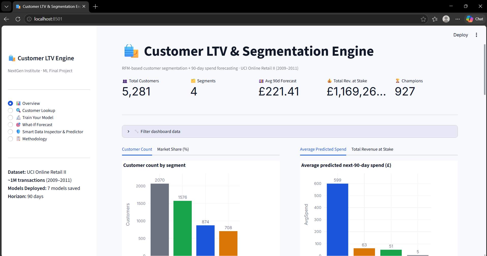

# Customer Lifetime Value & Segmentation Engine

**Project #02 · Retail & Marketing · Clustering + Regression**  
NextGen Institute — Machine Learning Final Project

## 📌 Problem Framing
An online retailer treats every customer the same, wasting marketing budget on people who will never buy again while ignoring their most loyal shoppers. This project builds a machine learning engine that segments customers based on their purchasing behavior and predicts how much each active customer will spend in the next 90 days. This allows the marketing team to target customers with personalized campaigns (e.g., VIP rewards, win-back emails) instead of blanket discounts.

---

## 🚀 Live Demo & Links
* **Streamlit App:** [Customer LTV & Segmentation Engine](https://nextgenproject-ziwww8dcz7t6vmqemusmxc.streamlit.app/)
* **GitHub Repo:** [NextGen Project Repository](https://github.com/ahmedayad0168/NextGen_project)
* **Dataset:** [UCI Online Retail II](https://archive.ics.uci.edu/dataset/502)

## 📸 App Screenshot
**

---

## 📊 Results

Final temporal test set — **5,281 customers**. Feature cutoff **2011-09-10**, target = spend in the next 90 days (no data leakage).

| Model | MAE (£) | RMSE (£) | R² |
|---|---:|---:|---:|
| **Baseline:** recent 180-day spend ÷ 2 | 637.21 | 2,916.75 | 0.575 |
| CatBoost (ML only) | 733.21 | 3,354.69 | 0.438 |
| **Final Best Model:** 88% ML + 12% baseline | **725.04** | **3,327.64** | **0.447** |

* **Unsupervised Clustering:** K-Means (k=4) achieved a Silhouette score of **0.371**.
* **Supervised Modeling:** We compared a Baseline, Linear Regression, Random Forest, Gradient Boosting, and CatBoost (all inside `scikit-learn` pipelines). 

---

## 👥 Customer Segments & Business Insights

| Segment | Observed Behavior | Recommended Business Action |
|---|---|---|
| **Champions** | Very recent, high frequency, high spend | VIP recognition; early access to new products; premium service. |
| **Active Customers** | Very recent; moderate frequency/spend | Cross-sell complementary products & loyalty engagement. |
| **At-Risk High-Value** | Longer gap since last purchase; historically high spend | Personalised win-back campaign with high-priority offers. |
| **Hibernating Customers** | Long absence; low historical spend | Low-cost reactivation campaigns; suppress if no response to save budget. |

---

## 🛠️ Methodology (What I Did)

1. **Data Understanding & Cleaning:** Loaded ~1M transactions from the UCI Online Retail II dataset. Removed cancellations (`C` invoices), missing Customer IDs, and negative quantities/prices.
2. **Feature Engineering:** Created RFM (Recency, Frequency, Monetary) metrics, rolling spend windows (30/60/90/180 days), tenure, and average order value. 
3. **Target Creation:** Split data chronologically (cutoff: 2011-09-10) to prevent data leakage. Created the target variable (Next 90-Day Spend).
4. **Unsupervised Modeling:** Used `StandardScaler` and K-Means clustering to segment customers. Compared against Hierarchical Clustering.
5. **Supervised Modeling:** Built a `scikit-learn Pipeline` for each model to prevent leakage. Predicted the log-transformed spend to handle skewness.
6. **Tuning & Evaluation:** Used `GridSearchCV` to tune the CatBoost model on the training data. Evaluated on the untouched test set using MAE, RMSE, and R².
7. **Deployment:** Exported the trained pipelines using `joblib` and built a multi-page Streamlit app.

---

## 💻 How to Run Locally

### 1. Clone the Repository & Install Requirements
```bash
git clone https://github.com/ahmedayad0168/NextGen_project
cd final-project
python -m venv .venv

# Windows
.venv\Scripts\activate
# macOS / Linux
source .venv/bin/activate

pip install -r requirements.txt
```

### 2. Download the Dataset Automatically
We provided a script to automatically download and extract the data into the `data/` folder:
```bash
python download_data.py
```

### 3. Launch the App
Run the Streamlit dashboard:
```bash
streamlit run app.py
```

### 4. Retrain the Models (Optional)
If you want to re-run the machine learning pipeline from scratch, open `final_project.ipynb` in Jupyter and run all cells. This will regenerate the models and save them into the `models/` folder.

---

## 📁 Project Structure
```text
├── app.py                          # Streamlit dashboard (6 interactive pages)
├── final_project.ipynb             # ML pipeline, EDA, and model training notebook
├── download_data.py                # Script to auto-download the UCI dataset
├── requirements.txt                # Python dependencies
├── README.md                       
├── data/                           # Data folder (contains customer profiles)
├── models/                         # Saved ML pipelines (.joblib)
└── reports/                        # CSV evaluation metrics and feature importances
```

---

## 📄 Dataset Citation
Chen, D. (2012). *Online Retail II*. UCI Machine Learning Repository. https://archive.ics.uci.edu/dataset/502
```
